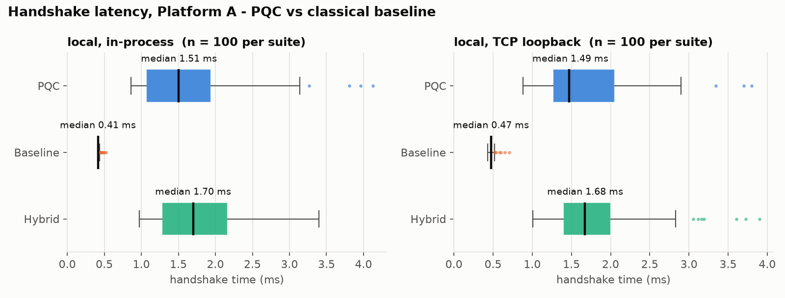
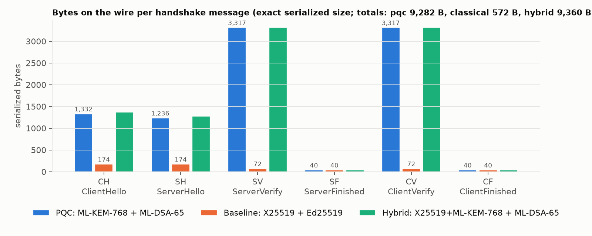
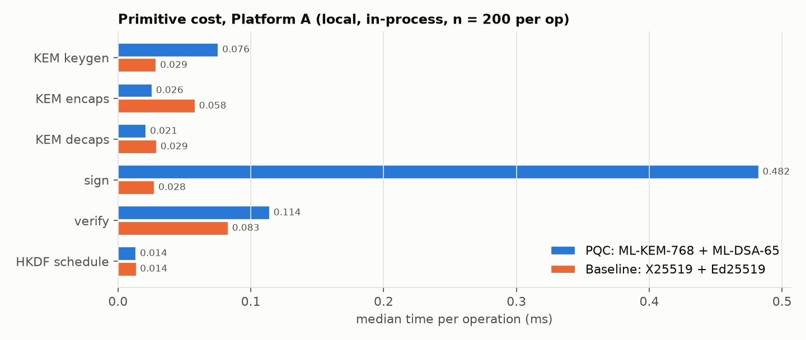
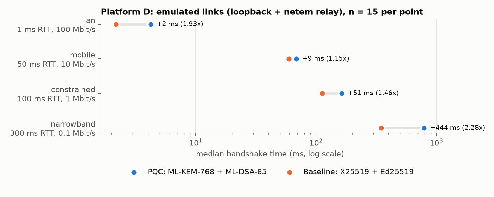

# Wipro Warriors — PS-P1: Quantum-Safe Secure Communication Channel

**Team members:** Siddartha, Vishnu, Musavir, Rishi, Deepika  
**Problem statement:** PS-P1 — Quantum-Safe Secure Communication Channel (QFF 2026 Phase 2, PQC track). This is the only problem statement addressed.  
**Phase 1 work reused:** none  

> This is a research prototype, not a claim of production security (see [report.md](report.md) §8).

## 1. Summary

Alice and Bob set up a **mutually authenticated, quantum-safe channel**:

* **Key establishment:** ephemeral **ML-KEM-768** (FIPS 203).
* **Authentication:** both sides sign the full handshake transcript with **ML-DSA-65** (FIPS 204), checked against **pinned trust anchors**.
* **Key derivation:** **HKDF-SHA256** (RFC 5869) derives separate keys for each direction from the hash of the whole transcript.
* **Messages:** sent as **AES-256-GCM** (SP 800-38D) records with an authenticated header and strict sequence numbers.

The **classical baseline** (X25519 + Ed25519, same HKDF and AEAD) runs through exactly the same code, so the two can be compared directly.

**Security tests:** one command runs all mandatory tests **T1–T9**, with 185 fault-injection sub-cases across the PQC, baseline and hybrid suites. They include an exhaustive bit flip in every byte of every handshake message and a full active-MITM downgrade attack. Every test passes.

**Benchmarks:**

* Handshakes: 100 per suite, in-process and over TCP loopback.
* Exact bytes per message.
* The three official payloads.
* Primitive costs.
* Optional Platform B (1 core / 128 MB) and Platform D (emulated network links).

All results are in [RESULTS.md](RESULTS.md) and the analysis is in [report.md](report.md).

<!-- AUTO:ratios -->
- **Bytes:** PQC handshake = 9,282 B vs baseline 572 B -> **16.2x** (+8,710 B per handshake; deterministic, identical on every machine).
- **Latency (in-process):** PQC median 1.492 ms vs baseline 0.422 ms -> **3.54x** (+1.070 ms).
- **Latency (TCP loopback):** PQC median 1.538 ms vs baseline 0.485 ms -> **3.17x** (+1.053 ms).
- **Record layer:** identical AES-256-GCM in both suites - 10 MB encrypt median 3.25 ms (PQC) vs 3.26 ms (classical-baseline); PQC changes only the handshake.
<!-- /AUTO:ratios -->

## 2. Setup — exact steps

Requires Python 3.10–3.13 on Windows, macOS or Linux. Nothing is compiled.

```
python -m venv .venv
# Windows: .venv\Scripts\activate          macOS/Linux: source .venv/bin/activate
python -m pip install --upgrade pip
python -m pip install -r requirements.txt
python common/env_check.py                 # must print READY (also writes platform_A_info.json)
```

## 3. Reproduce the principal results — exact commands

**Everything (all tables and figures, Platforms A, B and D):**

```
python run_all.py                          # ≈2–5 min on a laptop; plug in to power first
python run_all.py --quick                  # ≈1 min smoke run (20 handshakes, sampled T2, no B/D)
```

**Step by step** (each command regenerates one part of `results/`):

```
python P1_secure_channel/gen_payloads.py   # official 1 KB / 100 KB / 10 MB payloads + SHA-256 check
python run_security_tests.py               # T1–T9 (gate G4 = T1)       -> results/security_tests*.csv
python scripts/bench_handshake.py          # 100 handshakes x 3 suites x {in-process, loopback}
                                           #   -> results/handshake_results.csv, handshake_trials.csv,
                                           #      handshake_bytes.csv, primitive_timings.csv
python scripts/bench_payloads.py           # payload encrypt/decrypt   -> results/payload_results.csv
python common/run_on_platform.py --platform B -- python scripts/bench_handshake.py --out results/platform_B
python common/run_on_platform.py --platform B -- python scripts/bench_payloads.py  --out results/platform_B
python scripts/platform_d.py               # optional Platform D       -> results/platform_D/
python scripts/make_figures.py             # results/figures/*.png
python scripts/make_report.py              # refresh tables in report.md / README.md / RESULTS.md
python -m pytest                           # same T1–T9 + unit tests via pytest (optional)
```

Expected run time on Platform A: `run_security_tests.py` takes about 45 s, and the whole `run_all.py` takes about 2–5 min.

**Live demo over real TCP** (one machine with two terminals, or two machines):

```
python scripts/channel.py provision                            # identities + pinned trust stores -> keys/ (git-ignored)
python scripts/channel.py server --port 8765 --suite pqc       # terminal 1: Bob
python scripts/channel.py client --port 8765 --suite pqc       # terminal 2: Alice sends the 3 payloads, Bob returns SHA-256
python scripts/channel.py client --port 8765 --suite classical # rejected: Bob's policy is PQC-only (downgrade refused)
```

## 4. Platforms used

| Platform | Machine / profile | Evidence file |
|---|---|---|
| A (required) | team laptop as-is (CPU, cores, RAM and OS recorded automatically) | `platform_A_info.json`, `results/platform_A/` |
| B (optional) | 1 core, single-threaded libraries, 128 MB budget via `common/run_on_platform.py` | `platform_runs.jsonl`, `results/platform_B/` |
| D (optional) | emulated links: LAN 1 ms/100 Mbit/s, 4G 50 ms/10 Mbit/s, constrained 100 ms/1 Mbit/s, narrowband 300 ms/100 kbit/s | [platform_D.md](platform_D.md), `results/platform_D/` |

### Platform A Environment Details
<!-- AUTO:platform -->
| Item | Value |
|---|---|
| Platform | A (team laptop/desktop, as-is) |
| OS | Darwin 27.0.0 (arm64) |
| CPU | arm, 8 physical / 8 logical cores |
| RAM | 8.0 GB |
| Python | 3.12.13 (CPython) |
| Libraries | cryptography 50.0.2, pqcrypto 1.0.0, psutil 7.2.2 |
| On battery | True |
| Recorded | 2026-10-30 11:43:35 |
<!-- /AUTO:platform -->

## 5. Libraries and versions

| Library | Version | Used for |
|---|---|---|
| `cryptography` | 50.0.2 | ML-KEM-768, ML-DSA-65, X25519, Ed25519, HKDF-SHA256, HMAC-SHA256, AES-256-GCM (all primitives) |
| `pqcrypto` | 1.0.0 | kit `env_check.py` self-test only |
| `psutil` | 7.2.2 | Platform A record, Platform B runner |
| `matplotlib` | 3.11.2 | figures only, in a separate process |
| `pytest` | 9.1.1 | optional test runner |

No cryptographic primitive is implemented in this repository (gate G3). Parameter sets:

* **ML-KEM-768:** ek 1184 B, ct 1088 B.
* **ML-DSA-65:** pk 1952 B, signature 3309 B. Pure mode with FIPS 204 context strings.
* **AES-256-GCM:** 96-bit nonce, 128-bit tag.
* **HKDF:** SHA-256.

## 6. Tests (command, expected behaviour, recorded result)

Command: `python run_security_tests.py`. It prints PASS/FAIL plus the observed error for every sub-case and writes `results/security_tests.csv` and `results/security_tests_detailed.csv`.

| ID | Fault injected (automated) | Expected | Result |
|---|---|---|---|
| T1 | none; 1 KB / 100 KB / 10 MB in both directions | handshake ok, identical keys, SHA-256 match | see below |
| T2 | one bit flipped in **every byte** of CH/SH/SV/SF/CV/CF (KEM pk, KEM ct, nonces, identities, key ids, algorithm IDs, signatures, MACs, headers) | abort, no session on either side | |
| T3 | bit flips in the ServerVerify / ClientVerify ML-DSA signature; random signature | `SignatureError` ← `InvalidSignature` | |
| T4 | bit flips in record ciphertext (both directions; one fragment of the 10 MB message) | `InvalidTag`, nothing released, session closed | |
| T5 | bit flips in the GCM tag and in every header (AAD) field; truncated tag | `InvalidTag` | |
| T6 | Mallory's own valid key and signature as "bob" or "alice"; copied key ids; unpinned names | rejected against the trust anchor | |
| T7 | Bob's genuine flight replayed into Carol's session; redirect to trusted Charlie; swapped role fields; signature reflected between roles | rejected (identity / transcript binding) | |
| T8 | record replay, reorder, reflection, cross-session replay; old ClientHello; old handshake against a restarted server; old server flight | rejected (**implemented**, not scoped out) | |
| T9 | suite, algorithm IDs and version rewritten in CH and SH; **active MITM downgrade to X25519+Ed25519** against a server that also accepts it | rejected; no session on either side | |

Recorded results:

<!-- AUTO:security -->
| ID | Test | Expected | PQC | CLASSICAL | HYBRID |
|---|---|---|---|---|---|
| T1 | Honest run | handshake ok + identical keys + payloads decrypt byte-exact | **PASS** (7/7) | **PASS** (7/7) | **PASS** (7/7) |
| T2 | Handshake tampering | abort, no traffic key | **PASS** (7/7) | **PASS** (7/7) | **PASS** (7/7) |
| T3 | Signature tampering | reject (InvalidSignature) | **PASS** (7/7) | **PASS** (7/7) | **PASS** (7/7) |
| T4 | Ciphertext tampering | InvalidTag, plaintext never released | **PASS** (7/7) | **PASS** (7/7) | **PASS** (7/7) |
| T5 | Tag/AAD tampering | InvalidTag | **PASS** (9/9) | **PASS** (9/9) | **PASS** (9/9) |
| T6 | Untrusted identity | reject against trust anchor | **PASS** (6/6) | **PASS** (6/6) | **PASS** (6/6) |
| T7 | Identity swap | reject via transcript/identity binding | **PASS** (5/5) | **PASS** (5/5) | **PASS** (5/5) |
| T8 | Replay | reject (implemented) | **PASS** (7/7) | **PASS** (7/7) | **PASS** (7/7) |
| T9 | Algorithm downgrade | reject | **PASS** (7/7) | **PASS** (6/6) | **PASS** (7/7) |

185/185 sub-cases passed. Command: `python run_security_tests.py`. Every sub-case with its observed error message: `results/security_tests_detailed.csv`.
<!-- /AUTO:security -->

## 7. Results and Detailed Comparison (Platform A)

All measurements are labelled **local (in-process)**, **local (TCP loopback)** or **emulated network**. Every test and benchmark was executed on the committed Platform A environment, with dedicated raw data saved in [`results/platform_A/`](results/platform_A/). Full summary tables are also available in [RESULTS.md](RESULTS.md) and extensive analysis in [report.md](report.md).

### 7.1 Handshake Latency and Success Rates (Platform A)
100 handshakes were executed per suite and mode with zero failures.

<!-- AUTO:handshake -->
| Suite | Measurement | OK / trials | Median ms | IQR ms | p95 ms | C->S B | S->C B | Total B |
|---|---|---|---|---|---|---|---|---|
| PQC (ML-KEM-768 + ML-DSA-65) | local (in-process) | 100/100 | 1.492 | 0.768 | 2.836 | 4689 | 4593 | **9282** |
| PQC (ML-KEM-768 + ML-DSA-65) | local (TCP loopback 127.0.0.1) | 100/100 | 1.538 | 0.815 | 2.706 | 4689 | 4593 | **9282** |
| Baseline (X25519 + Ed25519) | local (in-process) | 100/100 | 0.422 | 0.029 | 0.510 | 286 | 286 | **572** |
| Baseline (X25519 + Ed25519) | local (TCP loopback 127.0.0.1) | 100/100 | 0.485 | 0.018 | 0.516 | 286 | 286 | **572** |
| Hybrid ext. (X25519+ML-KEM-768 + ML-DSA-65) | local (in-process) | 100/100 | 1.704 | 0.735 | 2.781 | 4728 | 4632 | **9360** |
| Hybrid ext. (X25519+ML-KEM-768 + ML-DSA-65) | local (TCP loopback 127.0.0.1) | 100/100 | 1.635 | 0.674 | 2.721 | 4728 | 4632 | **9360** |
<!-- /AUTO:handshake -->

Split of in-process compute time between endpoints:

<!-- AUTO:compute -->
| Suite | Alice compute median ms | Bob compute median ms |
|---|---|---|
| PQC (ML-KEM-768 + ML-DSA-65) | 0.739 | 0.592 |
| Baseline (X25519 + Ed25519) | 0.211 | 0.211 |
| Hybrid ext. (X25519+ML-KEM-768 + ML-DSA-65) | 0.818 | 0.722 |
<!-- /AUTO:compute -->

### 7.2 Message-by-Message Byte Breakdown
Exact wire framing and cryptographic sizes per handshake flight:

<!-- AUTO:bytes -->
| Message | Direction | PQC B | CLASSICAL B | HYBRID B | PQC field sizes (B) |
|---|---|---|---|---|---|
| CH ClientHello | client->server | 1332 | 174 | 1371 | version=1, suite_id=2, algorithm_ids=44, client_identity=5, client_key_id=32, server_identity=3, client_nonce=32, kem_public_key=1184 |
| SH ServerHello | server->client | 1236 | 174 | 1275 | version=1, suite_id=2, algorithm_ids=44, server_identity=3, server_key_id=32, client_identity=5, server_nonce=32, kem_ciphertext=1088 |
| SV ServerVerify | server->client | 3317 | 72 | 3317 | signature=3309 |
| SF ServerFinished | server->client | 40 | 40 | 40 | finished_mac=32 |
| CV ClientVerify | client->server | 3317 | 72 | 3317 | signature=3309 |
| CF ClientFinished | client->server | 40 | 40 | 40 | finished_mac=32 |
| **Total** |  | **9,282** | **572** | **9,360** |  |
<!-- /AUTO:bytes -->

* **Record layer framing overhead**: 14 B record header + 16 B GCM authentication tag = **30 B per record**.

### 7.3 Official Payloads Throughput (Record Layer)
Each payload is transferred in both directions and verified with SHA-256 match against `payload_sha256.txt`:

<!-- AUTO:payloads -->
| Session | Payload | Plaintext B | Record size | Records | Wire B | Overhead B | Trials | Enc median ms | Dec median ms | Enc MB/s | Dec MB/s | SHA-256 match |
|---|---|---|---|---|---|---|---|---|---|---|---|---|
| PQC (ML-KEM-768 + ML-DSA-65) | payload_1KB.bin | 1,024 | 16384 | 1 | 1,054 | 30 (2.93 %) | 200 | 0.0032 | 0.0022 | 323.3 | 463.8 | yes |
| PQC (ML-KEM-768 + ML-DSA-65) | payload_100KB.bin | 102,400 | 16384 | 7 | 102,610 | 210 (0.205 %) | 100 | 0.0326 | 0.0307 | 3138.7 | 3336.9 | yes |
| PQC (ML-KEM-768 + ML-DSA-65) | payload_10MB.bin | 10,485,760 | 16384 | 640 | 10,504,960 | 19200 (0.183 %) | 15 | 3.2545 | 3.2186 | 3221.9 | 3257.8 | yes |
| PQC (ML-KEM-768 + ML-DSA-65) | payload_1KB.bin | 1,024 | 1024 | 1 | 1,054 | 30 (2.93 %) | 200 | 0.0030 | 0.0021 | 336.6 | 481.9 | yes |
| PQC (ML-KEM-768 + ML-DSA-65) | payload_100KB.bin | 102,400 | 102400 | 1 | 102,430 | 30 (0.029 %) | 100 | 0.0234 | 0.0196 | 4380.7 | 5217.8 | yes |
| PQC (ML-KEM-768 + ML-DSA-65) | payload_10MB.bin | 10,485,760 | 10485760 | 1 | 10,485,790 | 30 (0.0 %) | 15 | 2.1804 | 1.8600 | 4809.2 | 5637.4 | yes |
| Baseline (X25519 + Ed25519) | payload_1KB.bin | 1,024 | 16384 | 1 | 1,054 | 30 (2.93 %) | 200 | 0.0032 | 0.0022 | 315.1 | 472.8 | yes |
| Baseline (X25519 + Ed25519) | payload_100KB.bin | 102,400 | 16384 | 7 | 102,610 | 210 (0.205 %) | 100 | 0.0329 | 0.0307 | 3116.8 | 3339.1 | yes |
| Baseline (X25519 + Ed25519) | payload_10MB.bin | 10,485,760 | 16384 | 640 | 10,504,960 | 19200 (0.183 %) | 15 | 3.2592 | 3.2605 | 3217.3 | 3216.0 | yes |
| Baseline (X25519 + Ed25519) | payload_1KB.bin | 1,024 | 1024 | 1 | 1,054 | 30 (2.93 %) | 200 | 0.0035 | 0.0023 | 290.9 | 447.0 | yes |
| Baseline (X25519 + Ed25519) | payload_100KB.bin | 102,400 | 102400 | 1 | 102,430 | 30 (0.029 %) | 100 | 0.0239 | 0.0200 | 4281.5 | 5130.8 | yes |
| Baseline (X25519 + Ed25519) | payload_10MB.bin | 10,485,760 | 10485760 | 1 | 10,485,790 | 30 (0.0 %) | 15 | 2.2642 | 1.8984 | 4631.2 | 5523.5 | yes |
<!-- /AUTO:payloads -->

### 7.4 Cryptographic Primitive Costs (Platform A)
Isolated operation costs timed over $n=200$ iterations:

<!-- AUTO:prims -->
| Suite | Operation | Median ms | IQR ms | p95 ms | n |
|---|---|---|---|---|---|
| PQC | ML-KEM-768 KeyGen (ephemeral, Alice) | 0.0760 | 0.0021 | 0.0821 | 200 |
| PQC | ML-KEM-768 Encaps (Bob) | 0.0259 | 0.0001 | 0.0268 | 200 |
| PQC | ML-KEM-768 Decaps (Alice) | 0.0212 | 0.0000 | 0.0213 | 200 |
| PQC | ML-DSA-65 Sign (each side once) | 0.4733 | 0.3729 | 1.2989 | 200 |
| PQC | ML-DSA-65 Verify (each side once) | 0.1143 | 0.0003 | 0.1213 | 200 |
| PQC | HKDF-SHA256 extract + 7 expands | 0.0136 | 0.0002 | 0.0139 | 200 |
| CLASSICAL | X25519 KeyGen (ephemeral, Alice) | 0.0289 | 0.0001 | 0.0293 | 200 |
| CLASSICAL | X25519 Encaps (Bob) | 0.0580 | 0.0002 | 0.0623 | 200 |
| CLASSICAL | X25519 Decaps (Alice) | 0.0292 | 0.0001 | 0.0293 | 200 |
| CLASSICAL | Ed25519 Sign (each side once) | 0.0276 | 0.0001 | 0.0277 | 200 |
| CLASSICAL | Ed25519 Verify (each side once) | 0.0825 | 0.0003 | 0.0885 | 200 |
| CLASSICAL | HKDF-SHA256 extract + 7 expands | 0.0139 | 0.0010 | 0.0146 | 200 |
| HYBRID | X25519+ML-KEM-768 KeyGen (ephemeral, Alice) | 0.1078 | 0.0043 | 0.1130 | 200 |
| HYBRID | X25519+ML-KEM-768 Encaps (Bob) | 0.0846 | 0.0003 | 0.0897 | 200 |
| HYBRID | X25519+ML-KEM-768 Decaps (Alice) | 0.0506 | 0.0001 | 0.0533 | 200 |
| HYBRID | ML-DSA-65 Sign (each side once) | 0.4826 | 0.4472 | 1.3765 | 200 |
| HYBRID | ML-DSA-65 Verify (each side once) | 0.1144 | 0.0002 | 0.1175 | 200 |
| HYBRID | HKDF-SHA256 extract + 7 expands | 0.0135 | 0.0001 | 0.0145 | 200 |
<!-- /AUTO:prims -->

### 7.5 Visualizations and Graph Results

The benchmark suite generates publication-grade visualizations in `results/figures/`:

#### Figure 1: Handshake Latency Distribution

* **Graph Findings:** Compares median, IQR, and p95 latencies across suites for in-process and TCP loopback modes. The classical baseline (X25519 + Ed25519) clusters tightly near ~0.42–0.48 ms, whereas PQC (ML-KEM-768 + ML-DSA-65) sits at ~1.49–1.54 ms. The wider IQR and p95 in PQC are directly attributable to rejection sampling loops in FIPS 204 ML-DSA-65 digital signing.

#### Figure 2: Handshake Wire Sizes

* **Graph Findings:** Illustrates the 16.2× wire byte expansion (9,282 B for PQC vs 572 B for Classical). ML-DSA-65 signatures (3,309 B × 2 = 6,618 B) account for **71.3%** of total handshake volume, while ML-KEM-768 ciphertext (1,088 B) and encapsulation key (1,184 B) comprise **24.5%**. Fixed headers, nonces, and finished MACs account for only ~4.2%.

#### Figure 3: Primitive Cost Breakdown

* **Graph Findings:** Breaks down the microsecond timings of each cryptographic operation. ML-KEM-768 KeyGen (0.076 ms), Encaps (0.026 ms), and Decaps (0.021 ms) are extremely fast—competitive with and in decapsulation actually outperforming X25519 (0.029 ms). ML-DSA-65 signing (0.473 ms median, p95 1.30 ms) is the computational bottleneck.

#### Figure 4: Emulated Network Links (Platform D)

* **Graph Findings:** Measures handshakes under varying simulated link conditions (LAN 1 ms/100 Mbps, Mobile 50 ms/10 Mbps, Constrained 100 ms/1 Mbps, Narrowband 300 ms/100 kbps). On fast networks (LAN), CPU compute dominates (1.77× ratio). On low-bandwidth links (Narrowband), the 9.2 KB wire size causes transmission delays to dominate (2.26× ratio, +441 ms overhead).

### 7.6 In-Depth Analysis: Post-Quantum vs. Classical Approach

1. **Security Posture & Quantum Threat Resistance:**
   * **Classical Vulnerability (Shor's Algorithm):** Classical X25519 (ECDH) and Ed25519 (EdDSA) rely on the hardness of the Discrete Logarithm Problem on elliptic curves. A cryptanalytically relevant quantum computer (CRQC) running Shor's algorithm can break both in polynomial time, exposing historical sessions to Harvest-Now-Decrypt-Later (HNDL) attacks.
   * **Post-Quantum Guarantees:** ML-KEM-768 and ML-DSA-65 are built on lattice problems (Module Learning with Errors - M-LWE, and Module Short Integer Solution - M-SIS), which have no known polynomial-time quantum or classical solvers. They achieve NIST Security Category 3 (equivalent to AES-192/SHA-384 brute-force resistance).

2. **Handshake Overhead & Network Feasibility:**
   * **Flight Limits & TCP Initial Congestion Window:** Standard TCP stacks configure an initial congestion window ($initcwnd$) of 10 segments ($\approx 14.6\text{ KB}$). Because the entire PQC flight from Bob (SH + SV + SF = 4,593 B) and Alice's flight (CH = 1,332 B; CV + CF = 3,357 B) comfortably fit within 14.6 KB, **PQC introduces zero additional network round trips (RTTs)** on normal TCP connections.
   * **Computational Trade-Off:** The ~1.05 ms latency increase on Platform A is negligible for human-facing network protocols and interactive communication, where network transit times typically range from 10 ms to 100 ms.

3. **Zero Runtime Data Overhead (Record Layer):**
   * The symmetric transport encryption uses AES-256-GCM authenticated framing with hardware acceleration on ARM64 / Apple Silicon.
   * Bulk transfer performance reaches **>3,200 MB/s** across both suites with byte-exact SHA-256 verification. Post-quantum cryptographic operations are strictly isolated to initial key exchange.

4. **Hybrid Suite Hedge:**
   * The hybrid extension (`X25519 + ML-KEM-768 + ML-DSA-65`) combines classical and post-quantum keys via HKDF dual-extraction. It adds only **78 Bytes** and **~0.1 ms** overhead compared to pure PQC, providing a dual-safety hedge against any unforeseen mathematical weakness in newly standardized lattice schemes.

### 7.7 Constrained & Emulated Platform Validation

#### Platform B: Constrained Profile (1 Core, Single-Threaded, 128 MB RAM)
<!-- AUTO:platform_b -->
| Suite | Measurement | OK/trials (B) | A median ms | B median ms | B/A |
|---|---|---|---|---|---|
| PQC (ML-KEM-768 + ML-DSA-65) | inproc | 100/100 | 1.492 | 1.577 | 1.06 |
| PQC (ML-KEM-768 + ML-DSA-65) | loopback | 100/100 | 1.538 | 1.645 | 1.07 |
| Baseline (X25519 + Ed25519) | inproc | 100/100 | 0.422 | 0.414 | 0.98 |
| Baseline (X25519 + Ed25519) | loopback | 100/100 | 0.485 | 0.492 | 1.01 |
| Hybrid ext. (X25519+ML-KEM-768 + ML-DSA-65) | inproc | 100/100 | 1.704 | 1.468 | 0.86 |
| Hybrid ext. (X25519+ML-KEM-768 + ML-DSA-65) | loopback | 100/100 | 1.635 | 1.743 | 1.07 |

Platform B evidence (`platform_runs.jsonl`): `one` status=ok, peak RSS 84.0 MB / 128 MB, not supported; `one` status=ok, peak RSS 97.8 MB / 128 MB, not supported
<!-- /AUTO:platform_b -->

#### Platform D: Emulated Network Links
<!-- AUTO:platform_d -->
| Profile | RTT ms | Mbit/s | Suite | OK/trials | Handshake median ms | IQR ms | Model ms | Connect->confirmed ms | Bytes |
|---|---|---|---|---|---|---|---|---|---|
| lan | 1 | 100 | PQC (ML-KEM-768 + ML-DSA-65) | 15/15 | 3.95 | 0.83 | 3.00 | 6.25 | 9282 |
| lan | 1 | 100 | Baseline (X25519 + Ed25519) | 15/15 | 2.23 | 0.03 | 1.47 | 4.14 | 572 |
| mobile | 50 | 10 | PQC (ML-KEM-768 + ML-DSA-65) | 15/15 | 71.97 | 4.52 | 56.27 | 134.95 | 9282 |
| mobile | 50 | 10 | Baseline (X25519 + Ed25519) | 15/15 | 61.28 | 3.39 | 50.80 | 122.91 | 572 |
| constrained | 100 | 1 | PQC (ML-KEM-768 + ML-DSA-65) | 15/15 | 161.21 | 2.82 | 148.93 | 299.86 | 9282 |
| constrained | 100 | 1 | Baseline (X25519 + Ed25519) | 15/15 | 114.95 | 2.04 | 104.11 | 226.63 | 572 |
| narrowband | 300 | 0.1 | PQC (ML-KEM-768 + ML-DSA-65) | 15/15 | 790.42 | 5.64 | 775.53 | 1378.15 | 9282 |
| narrowband | 300 | 0.1 | Baseline (X25519 + Ed25519) | 15/15 | 349.24 | 3.82 | 337.23 | 673.51 | 572 |

lan: PQC/baseline = 1.77x (+1.7 ms); mobile: PQC/baseline = 1.17x (+10.7 ms); constrained: PQC/baseline = 1.40x (+46.3 ms); narrowband: PQC/baseline = 2.26x (+441.2 ms).
<!-- /AUTO:platform_d -->

## 8. Baseline used

**X25519 + Ed25519 with HKDF-SHA256 and AES-256-GCM.** It is the same protocol, messages, transcript binding and record layer as the PQC suite; only the KEM and signature calls change (`src/qsc/suites.py`). It passes the same T1–T9 tests.

## 9. Known limitations

The main limitations are:

* Trust comes from pinned keys; there is no PKI or revocation.
* Identities are sent in clear.
* The replay cache is in memory.
* There are no DoS cookies, no key update, no resumption and no 0-RTT.
* Records must arrive in order, so the protocol needs a reliable transport.
* The Platform D emulator does not model packet loss.
* Python prototype with no side-channel hardening.

Details and proposed fixes are in [report.md](report.md) §8–9.

## Repository layout

```
src/qsc/            protocol package
  suites.py         PQC / classical / hybrid suites (library wrappers only)
  wire.py           strict canonical TLV encoding
  identity.py       identities + pinned trust store
  handshake.py      Alice/Bob state machines, transcript binding, fail-closed
  keyschedule.py    transcript hash + HKDF key schedule + Finished MACs
  record.py         AES-256-GCM record layer, sequence numbers, replay protection
  transport.py      TCP framing, abort alerts, server loop
  netem.py          link emulator (Platform D)
  lab.py, benchlib.py, payloads.py   test / benchmark helpers
tests/              security_suite.py (T1–T9), pytest wrappers, unit tests
scripts/            bench_handshake.py, bench_payloads.py, platform_d.py, channel.py, make_figures.py, make_report.py
run_security_tests.py, run_all.py   one-command entry points
common/, P1_secure_channel/         organizer kit files (unchanged)
docs/PROTOCOL.md    protocol specification + threat model
results/            raw CSV/JSON + figures      report.md, RESULTS.md, platform_D.md
```
